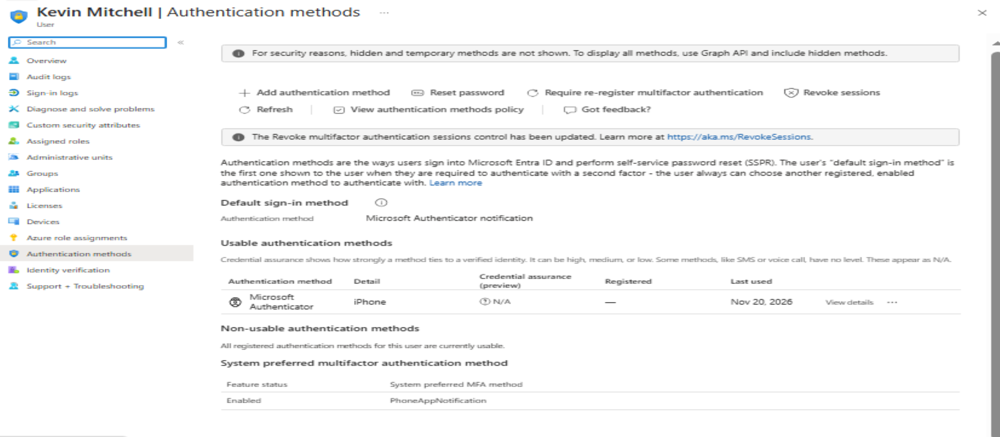
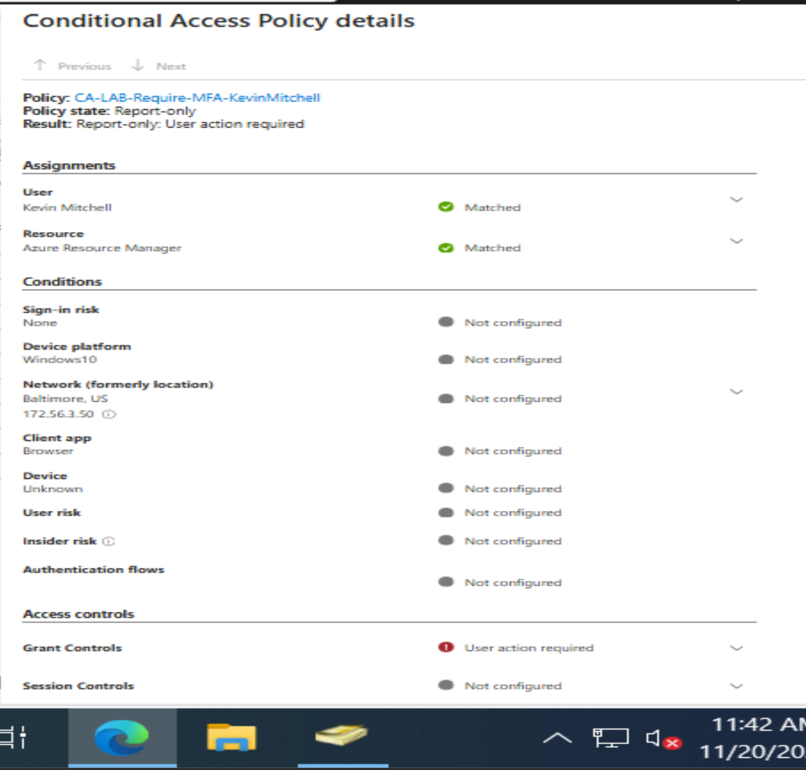
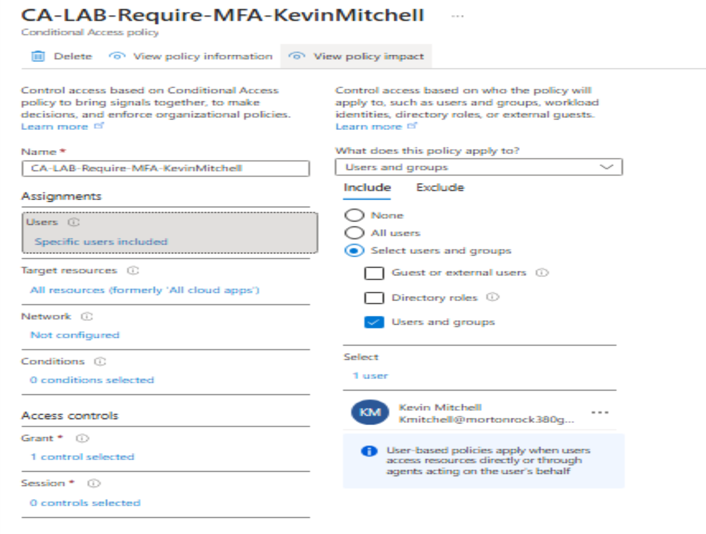
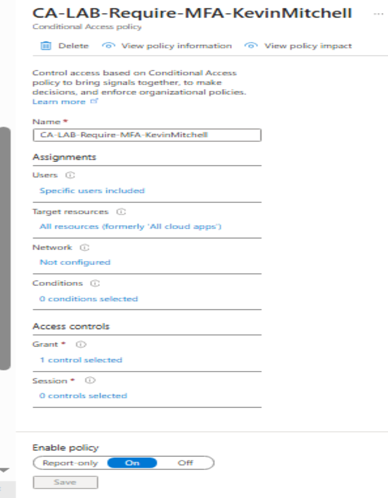
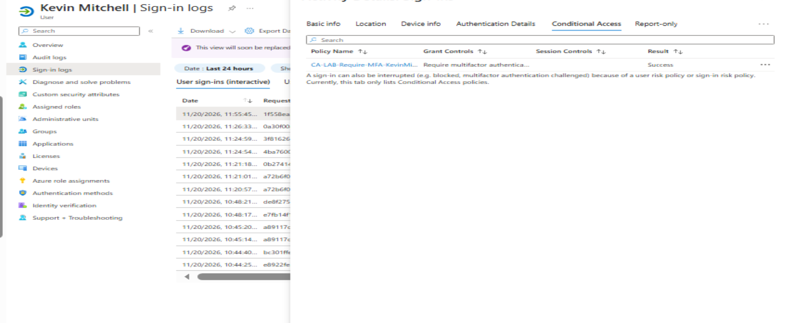
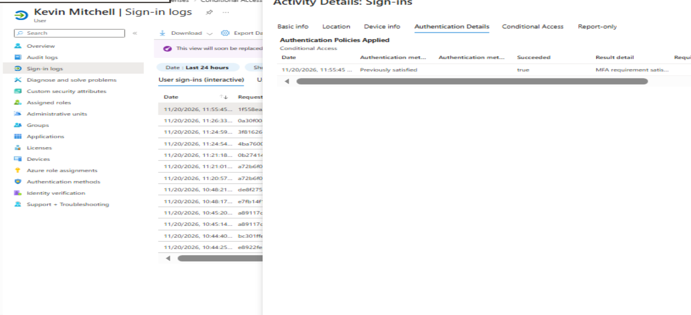

# Microsoft Entra ID — MFA & Conditional Access Security Lab

**Project 4 | IAM Security Analyst Portfolio | Controlled cloud-only training lab**

## Executive summary
Configured Microsoft Authenticator for a dedicated Microsoft Entra ID test user, deployed a user-scoped Conditional Access MFA policy, validated it in report-only mode, then examined an enabled-policy sign-in. Evidence shows **Conditional Access: Success** and an MFA requirement satisfied through a **previously satisfied authentication claim**. The selected final sign-in does **not** demonstrate a fresh MFA challenge.

## Scenario and objectives
Kevin Mitchell, a fictional Information Technology Security Analyst, serves as the cloud-only test user. The lab demonstrates identity security administration, safe policy rollout, and evidence-based troubleshooting—not a production rollout.

- Establish user and authentication-method baselines.
- Register and verify Microsoft Authenticator.
- Configure `CA-LAB-Require-MFA-KevinMitchell` for Kevin Mitchell only.
- Test in **Report-only** mode and inspect policy-matching results.
- Enable the scoped policy and inspect sign-in authentication details.

## Lab configuration

| Component | Configuration |
|---|---|
| Platform | Microsoft Entra ID |
| Identity | Kevin Mitchell, cloud-only |
| MFA method | Microsoft Authenticator (iPhone) |
| License | Entra ID P2 assignment reported; evidence filename 06 |
| Policy | `CA-LAB-Require-MFA-KevinMitchell` |
| Included user | Kevin Mitchell only |
| Target resources | All resources |
| Grant control | Grant access — Require multifactor authentication |
| Conditions | None configured |
| Rollout | Report-only evaluation, followed by enabled-policy test |

## Evidence-based results

| Stage | Observed result |
|---|---|
| Initial MFA state | No usable methods shown on user page |
| Registration | Microsoft Authenticator listed as usable |
| Report-only | User/resource matched; **User action required** |
| Enabled policy | Conditional Access policy result **Success** |
| Authentication details | **Previously satisfied**, succeeded **true**, MFA requirement satisfied |

**Interpretation:** Report-only evaluation predicted additional interaction would be needed; it did not enforce MFA. The later enabled-policy result confirms the requirement was met for the selected sign-in, using an existing authentication claim. A fresh Authenticator prompt was not demonstrated in that event.

## Documentation
- [Detailed IAM security case study](docs/IAM-CA-001-case-study.md)
- [Validation record and evidence interpretation](docs/IAM-CA-001-validation-record.md)
- [Screenshot inventory and upload instructions](screenshots/README.md)

## Selected screenshot evidence

### Authenticator registration

### Report-only policy evaluation

### Detailed report-only matching

### MFA grant configuration

### Enabled policy

### Authentication details

[Browse all 15 evidence screenshots](screenshots/README.md).

## Security and scope
This lab uses a dedicated test account to limit the blast radius of enforcement. It does not demonstrate a production deployment, enterprise approval, universal enforcement across all apps, or a fresh MFA challenge on the final sign-in. The 15 screenshot files have been uploaded to the repository.

## Skills demonstrated
Microsoft Entra ID · Identity and Access Management (IAM) · Multifactor Authentication (MFA) · Conditional Access · Report-only testing · Sign-in log investigation · Policy scoping · Security validation · Evidence documentation
